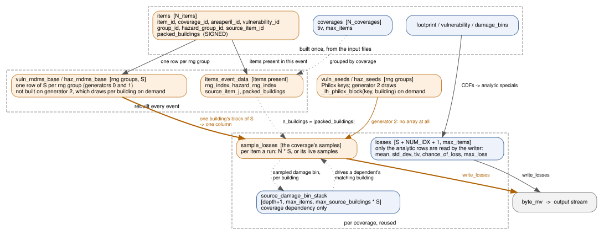
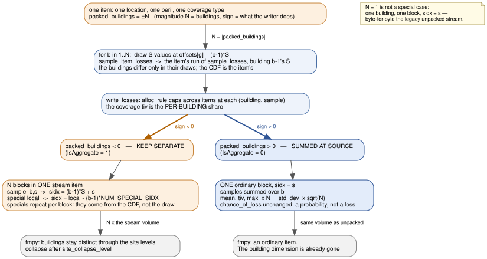
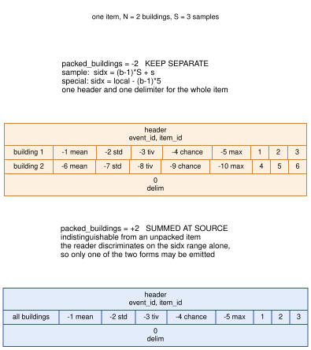

# GULMC — Ground-Up Loss Monte Carlo

## Overview

GULMC computes ground-up losses (GUL) for catastrophe risk models using full Monte Carlo
sampling. It processes events one at a time from a binary input stream: for each event, it
retrieves the hazard footprint, maps items to coverages, generates random numbers, computes
vulnerability CDFs, samples losses, and writes binary output.

All performance-critical code paths use Numba JIT compilation (`@nb.njit`).

## Module Structure

```
gulmc/
├── cli.py          # CLI entry point and argument parsing
├── common.py       # Numba-compatible data type definitions and constants
├── items.py        # Item loading and item_map generation
├── aggregate.py    # Aggregate vulnerability definitions and weight processing
├── manager.py      # Main orchestration: run(), event loop, and all Numba-compiled functions
└── README.md       # This file
```

Shared modules in `gul/`:
```
gul/
├── random.py       # Random number generation (Mersenne Twister, Latin Hypercube)
├── core.py         # Core math: get_gul(), compute_mean_loss(), split_tiv()
├── manager.py      # write_losses(), adjust_byte_mv_size()
└── utils.py        # binary_search()
```

## Data Flow

```
                       ┌──────────────────────────────────────────────────────┐
                       │                     run() setup                      │
                       │                                                      │
                       │  Load: items, coverages, correlations, vuln_array,  │
                       │        damage_bins, footprint index                  │
                       │  Build: item_map, areaperil_ids_map                  │
                       │  Pre-allocate: seeds, cdf cache, buffers             │
                       └───────────────────────┬──────────────────────────────┘
                                               │
                     ┌─────────────────────────▼─────────────────────────────┐
                     │              Event Loop (per event)                    │
                     │                                                       │
                     │  1. Read event_id from input stream                   │
                     │  2. get_event() → event_footprint                     │
                     │  3. process_areaperils_in_footprint()                 │
                     │     → areaperil_ids, haz_arr_i mapping, haz_pdf       │
                     │  4. reconstruct_coverages()                           │
                     │     → items_event_data, seeds, eff_cdf_ids            │
                     │  5. 2 sample draws + 2 correlation draws              │
                     │  6. Reset CDF cache lookup (Dict only, array reused)  │
                     │  7. compute_event_losses() [may loop for large events]│
                     │  8. Write output buffer to stream                     │
                     └───────────────────────────────────────────────────────┘
```

## Key Data Structures

### Items Table (`items`)

Structured numpy array built during setup by merging `items.bin` with `correlations.bin`, plus
`packed_buildings` read off `coverage_buildings` via each item's `coverage_id` (all ones when
that file is absent).
Extended with sequential index fields for O(1) lookups:

| Field | Type | Description |
|---|---|---|
| `item_id` | int32 | Unique item identifier |
| `coverage_id` | int32 | Coverage this item belongs to |
| `areaperil_id` | areaperil_int | Area-peril identifier (may be uint64) |
| `vulnerability_id` | int32 | Vulnerability function id |
| `group_id` | int32 | Group for damage random seed generation |
| `hazard_group_id` | int32 | Group for hazard random seed generation |
| `group_seq_id` | int32 | Sequential index for group_id (O6) |
| `hazard_group_seq_id` | int32 | Sequential index for hazard_group_id (O6) |
| `peril_correlation_group` | int32 | Peril correlation group |
| `damage_correlation_value` | float | Damage correlation strength |
| `hazard_correlation_value` | float | Hazard correlation strength |
| `source_item_id` | int32 | Coverage dependency: the item whose sampled damage drives this one; 0 if independent |
| `packed_buildings` | int32 | **Signed.** Magnitude is how many buildings this item carries; a negative sign means they must reach the financial module as separate blocks. 1 is the unpacked case. Read off the item's coverage, not stored per item. See [Building packing](#building-packing) |

### Per-Event Item Data (`items_event_data`)

Structured array of type `items_MC_data_type`, populated per event by `reconstruct_coverages`:

| Field | Type | Description |
|---|---|---|
| `item_id` | int32 | Item identifier |
| `item_idx` | int32 | Index into the items table |
| `rng_index` | int32 | Index into vuln_seeds / vuln_rndms_base |
| `hazard_rng_index` | int32 | Index into haz_seeds / haz_rndms_base |
| `intensity_adjustment` | int32 | Dynamic footprint intensity adjustment |
| `return_period` | int32 | Dynamic footprint return period |
| `source_item_j` | int32 | Coverage dependency: the source item's position within its coverage; < 0 if independent |
| `packed_buildings` | int32 | The signed building count, carried through from the items table |

The hazard row, the event's return period and the CDF group are not here: they belong to the
item's areaperil, of which an item can have several. See [Item areaperils](#item-areaperils).

### Item areaperils

For what blended areaperils do and the model data they need, see the user-facing page
`docs/source/explanation/blended-areaperils.md`. This section covers how gulmc implements them.

An item's `areaperil_id` names a **blended areaperil**: weighted placements, each read through
one footprint areaperil. Ids listed in the model's `blended_areaperil_id` table (see
`pytools/common/blended_areaperil.py`) take their placements from it. Every other id is a base
areaperil, the size-1 case: one placement of weight 1, read through the id itself. The item reads
one **item areaperil** per distinct non-zero footprint areaperil of its blended areaperil, in
order of first placement; `item_areaperil_ja_offsets[item_idx] + j` is its j-th. A blended
areaperil whose placements are all `areaperil_id = 0` has none, and its items never produce a
loss.

Placement is drawn once per run, when the structure is built: one Latin Hypercube block of S
uniforms per (location, building), keyed on the location's OED identifiers and not on the event, so
a building stands in the same place in every event of a sample. The placement index is stored once
per (location, building, sample) in `location_placements` (uint8 up to 255 placements), shared by
all the location's items, which is why every blended areaperil of a location must name the same
placement scheme (checked when the structure is built). An item with more than one placement finds
its run through `placement_item_ind` (an id_index over those items only) and `placement_item_starts`,
and maps each placement to its own areaperil_j through `blended_areaperil_placement_ja_areaperil_j`
(-1 when no areaperil covers it). Float weights falling short of 1 get one more placement, covered
by no areaperil, so a shortfall is drawn even when a scheme has a single real placement. An item
whose blended areaperil has one placement of weight 1, which is every item of a portfolio without
blending, never looks one up and reads j = 0, so these arrays are empty there.

Size: one byte per (location, building, sample) of the blended locations, so it grows with S. At
S = 1000, 250k single-building blended locations take 250 MB, memory-mapped and shared by the gulmc
processes.

Per event, `compute_event_losses` resolves the CDFs of all an item's live areaperils before
sampling, so each sample reads the one its placement falls on. The analytic values are the mixture
over the areaperils, weighted by `blended_areaperil_ja_probabilities`, for every item that does not
stand on its one areaperil with certainty (one areaperil read with probability below 1 is mixed
too). A coverage-dependency dependent is live or dead per placement like any item, and shares one set
of CDFs across them, since its CDFs come from its source's damage. Dead areaperils, uncovered
placements and a float weight shortfall carry no loss: in the mixed effective damage cdf
(`mix_effective_damage_cdfs`, shared with getmodel) their probability sits on damage bin 0, which
must be the zero-loss bin of the damage bin dictionary. Under a dynamic footprint the event's return
period is held per item areaperil, so an item's standard of protection is decided per placement: a
building can be protected where the event is a 1-in-20 and exposed where it is a 1-in-50. The
sections a blended location spans must be in sections.csv, which is the lookup's job, as for any
location.

| Array | Indexed by | Holds |
|---|---|---|
| `items['blended_areaperil_idx']` | item | dense blended areaperil index |
| `blended_areaperil_ja_offsets` / `_ja_probabilities` | blended areaperil | its K areaperils, and the probability the building is on each. Their footprint ids (`_ja_areaperil_ids`) are used while the structures are built and not kept: the event loop works with areaperil_j |
| `blended_areaperil_placement_ja_offsets` / `_ja_cum_weights` / `_ja_areaperil_j` | blended areaperil | placements: running weight, and which areaperil j covers each (-1 none). The uniform is scaled by `max(1, total weight)`, which is 1 for float weights and the total for counts |
| `location_placements` | (location, building, sample) | placement index, shared by the location's items; the placement count means unplaced |
| `placement_item_ind` / `placement_item_starts` | item with more than one placement | where its first building's samples start in `location_placements` |
| `item_areaperil_ja_offsets` | item | its run of item areaperils |
| `item_areaperil_ja_cdf_group_idxs` | item areaperil | CDF group, the cache key (one per areaperil, vulnerability and, under a dynamic footprint, intensity adjustment) |
| `item_areaperil_ja_areaperil_agg_vuln_idxs` | item areaperil | aggregate vulnerability block, -1 when not aggregate |
| `item_map_ja_id_ind` / `_ja_areaperil_ids` / `_ja_offsets` | footprint areaperil | the item areaperils that read it, as `item_map_ja_item_idxs` / `item_map_ja_item_areaperil_idxs` |
| `item_areaperil_haz_arr_i` | item areaperil | per event: index into haz_arr_ptr, -1 when its areaperil has no hazard this event |
| `item_areaperil_event_rp` | item areaperil | per event: the event's return period there (dynamic footprint) |
| `item_event_tag` | item | per event: the event it was last registered in, so it registers once |

### Vulnerability CDF Cache

A circular buffer that caches computed CDFs to avoid recomputation when multiple items
share the same vulnerability function and hazard conditions.

**Storage**: `cached_vuln_cdfs` — 2d array of shape `(Nvulns_cached, Ndamage_bins_max)`.
Pre-allocated once before the event loop (up to 200MB, configurable via `--vuln-cache-size`).
Reused across events without reallocation.

**Lookup**: `cached_vuln_cdf_lookup` — Numba Dict mapping `int64` keys to
`(slot_index, cdf_length)` tuples. Rebuilt (cleared) each event.

**Key encoding** (composite int64):
```
┌─────────────────────────────────┬─────────────────────────────────┐
│  upper 32 bits: eff_cdf_id      │  lower 32 bits: discriminator   │
└─────────────────────────────────┴─────────────────────────────────┘
```
- **Effective damage CDF**: `eff_cdf_id << 32 | 0xFFFFFFFF`
- **Per-bin vulnerability CDF**: `eff_cdf_id << 32 | haz_bin_id`

The `eff_cdf_id` is a sequential integer assigned per unique `(areaperil_id, vulnerability_id)`
pair during `reconstruct_coverages`. This avoids putting `areaperil_id` (potentially uint64)
in the cache key.

**Eviction**: circular (LRU-like). A write cursor advances through slots; when reusing a slot,
the old key is removed from the Dict. A reverse mapping (`cached_vuln_cdf_lookup_keys` list)
tracks which key occupies each slot.

## Core Functions (manager.py)

### `run(**kwargs)`

Main entry point. Loads all model data, sets up buffers, and runs the event loop.
Includes performance profiling instrumentation that prints per-phase timing to stderr.

### `process_areaperils_in_footprint(event_footprint, present_areaperils, dynamic_footprint)`

Filters the event footprint to retain only areaperils that have associated items.
Assigns a sequential `haz_arr_i` index (0, 1, 2, ...) to each retained areaperil, which is
used as the index into `haz_arr_ptr` for accessing the hazard intensity pdf.

### `reconstruct_coverages(...)`

Per-event preparation phase. Walks the item map for every areaperil in the footprint. The first
visit to an item registers it:
- Computes hash-based random seeds (deduplicated by group using array lookups).
- Maps items to their coverage structures.

Every visit records its item areaperil's hazard row, and gives the item a hazard rng row if that
areaperil's hazard is non-deterministic.

Uses pre-allocated arrays (`group_seq_rng_index`, `hazard_group_seq_rng_index`) for O(1)
group deduplication instead of per-event Numba Dict creation.

### `compute_event_losses(...)`

Core loss computation. For each coverage and item:
1. Retrieves hazard pdf via its item areaperil's `item_areaperil_haz_arr_i`.
2. Looks up or computes the effective damage CDF (and per-bin CDFs when
   `effective_damageability=False`), using the int64 cache key.
3. Computes mean loss statistics.
4. Samples losses using correlated or uncorrelated random values.
5. Writes results to the output byte buffer.

May return early (False) if the output buffer is full; the caller flushes and re-invokes.

### `cache_cdf(next_i, cdfs, lookup, keys, cdf, key)`

Stores a CDF in the circular cache. If the target slot is occupied, evicts the old entry
from the lookup Dict before overwriting.

## Building packing

A location with `NumberOfBuildings > 1` can be modelled without expanding it into one item per
building. `disaggregation='samples'` keeps a single item per (location, peril, coverage type) and
multiplexes that location's buildings into the **sample dimension** of one stream item. The
building count travels in its own `coverage_buildings` file, one signed record per coverage:
buildings belong to the location, so the coverage is the granularity at which the value is true,
and every item of a coverage inherits it. It is a file of its own rather than a column on
`coverages.bin` because that file is a published format third-party models parse directly.

The file exists only when some location has more than one building; absent, every count reads
as 1. The field is **signed**, and the sign is not a detail: it decides where the buildings
collapse.

| `n_building` | set when | gulmc writes | the buildings collapse |
|---|---|---|---|
| `-N` | `IsAggregate = 1` | N blocks in one stream item | in fmpy, after `site_collapse_level` |
| `+N` | `IsAggregate = 0` | one ordinary block, summed | here, at source |
| `1` | not packed | one ordinary block | nothing to collapse |

`N == 1` is not a special case in the code. An unpacked run is every item carrying one building,
and the packed generator's first block per seed is the legacy draw byte for byte, so the compute
always takes the packed route.

### How the stream declares it

The record layout does not change, so fmpy and summarypy read a packed stream with the same code
path -- an unpacked item is the one-building case of the packed encoding. What changes is the
**range** of `sidx`: a positive one runs to `buildings * S` rather than `S`, and the negative
specials repeat in blocks of 5 per building. An outside reader that trusts `sample_size` from the
header would index past its sample array on the second building and would not recognise that
building's specials -- silently, as a wrong loss rather than a failure.

So the stream says which it is, in the **aggregation type** of the 4-byte header word:

| aggregation type | value | meaning |
|---|---|---|
| `ITEM_STREAM` | 1 | one building per item; `sidx` in `[-5, S]` |
| `ITEM_PACKED_STREAM` | 3 | buildings multiplexed; `sidx` in `[-5B, B*S]` |

(2 is `COVERAGE_STREAM`, which has no producer and no defined packed form.)

gulmc and gulpy declare `ITEM_PACKED_STREAM` only when the run can actually emit a packed
`sidx` -- that is, when some item is **kept separate**. An item summed at source writes one
ordinary block however many buildings it covers, so a run that packs only those is byte-for-byte
a legacy stream, header included. fmpy's output is always `ITEM_STREAM`: the buildings have
collapsed by the time it writes.

Given `S` and the type, a reader recovers everything: `building = (sidx - 1) // S + 1` for a
sample, and `(-sidx - 1) // 5 + 1` for a special. No extra header field is needed.

### The objects



The building dimension appears in three places: `n_building` in the coverage_buildings file, the flat
random arrays (one block of S per building, per rng group), and `building_losses`, which holds one
column per building.

### How a packed item is written



Both modes draw the same way — each building gets its own block of S random values, so the
buildings differ only in their draws, never in their CDF. They diverge only at the writer.

A summed item scales its specials rather than repeating them: `mean`, `tiv` and `max_loss` are
additive so they are multiplied by N; `std_dev` grows with the root of the count, because the
buildings draw independently and it is their variances that add; `chance_of_loss` is a
probability, not a loss, so it is taken once.

### What reaches the stream



    sample  (b, s)      ->  sidx = (b - 1) * S + s
    special local < 0   ->  sidx = local - (b - 1) * NUM_SPECIAL_SIDX

One header and one delimiter bracket the whole item, whatever its building count. Consumers
recover the building from the sidx alone, which is why only one of the two forms may ever be
emitted for a given item: the reader discriminates on the sidx range, so if both kinds were
written packed it could not tell which to collapse.

## Computation Modes

### Effective Damageability (default: off)

When enabled (`--effective-damageability`), the effective damage CDF is sampled directly:
one CDF lookup per item per sample. Faster but less precise.

When disabled (default), the full Monte Carlo approach is used: for each sample, a hazard
intensity bin is first sampled from the hazard CDF, then the damage is sampled from the
per-bin vulnerability CDF. This requires caching both the effective damage CDF and all
per-bin CDFs.

### Aggregate Vulnerabilities

When a vulnerability_id maps to multiple underlying vulnerability functions
(`agg_vuln_to_vuln_idxs`), the CDFs are computed as a weighted average using
per-areaperil weights from `areaperil_vuln_idx_to_weight`.

### Dynamic Footprints

When enabled, intensity values in the hazard footprint are adjusted per item using
`intensity_adjustment` factors. The adjusted intensity is remapped to intensity_bin_ids
via `intensity_bin_dict`. Items with different adjustments in the same (areaperil, vuln)
group receive different CDF groups (`item_areaperil_ja_cdf_group_idxs`).

The footprint itself is built per event by `FootprintParquetDynamic` (`getmodel/footprint.py`),
including the merge of an areaperil lying in several sections (`--section-merge`); see the
dynamic footprint page of the documentation (`docs/source/explanation/dynamic-footprint.rst`).


## Binary I/O Format

**Input**: event_id stream (`eve.bin`) — sequence of int32 event ids.

**Output**: GUL sample-level stream — binary records per item:
```
Header:   [event_id: int32] [item_id: int32]
Records:  [sidx: int32] [loss: oasis_float]  (repeated per sample index)
```

Special sample indices (negative):
- `-5`: maximum loss
- `-4`: chance of loss
- `-3`: TIV (total insured value)
- `-2`: standard deviation
- `-1`: analytical mean

Positive indices `1..sample_size` are the Monte Carlo samples.

## Usage

```bash
gulmc --random-generator=2 \
  --model-df-engine='oasis_data_manager.df_reader.reader.OasisPandasReader' \
  --vuln-cache-size 200 \
  -S10 -L0 -a1 \
  -i runs/model/fifo/eve.bin \
  -o /dev/null \
  --run-dir runs/model
```

Key flags:
- `-S`: sample size
- `-L`: loss threshold
- `-a`: allocation rule (0, 1, 2, or 3)
- `--random-generator`: 0 = Mersenne Twister, 1 = Latin Hypercube, 2 = Latin Hypercube on Philox4x32-7 (counter-based; default)
- `--vuln-cache-size`: CDF cache size in MB (default 200)
- `--effective-damageability`: use effective damageability mode
- `--ignore-correlation`: skip hazard/damage correlation
